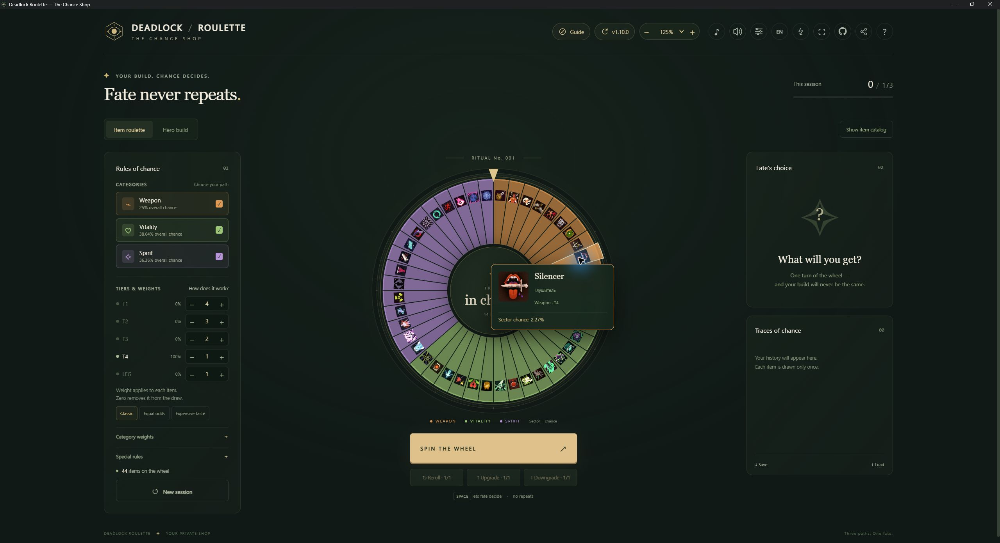
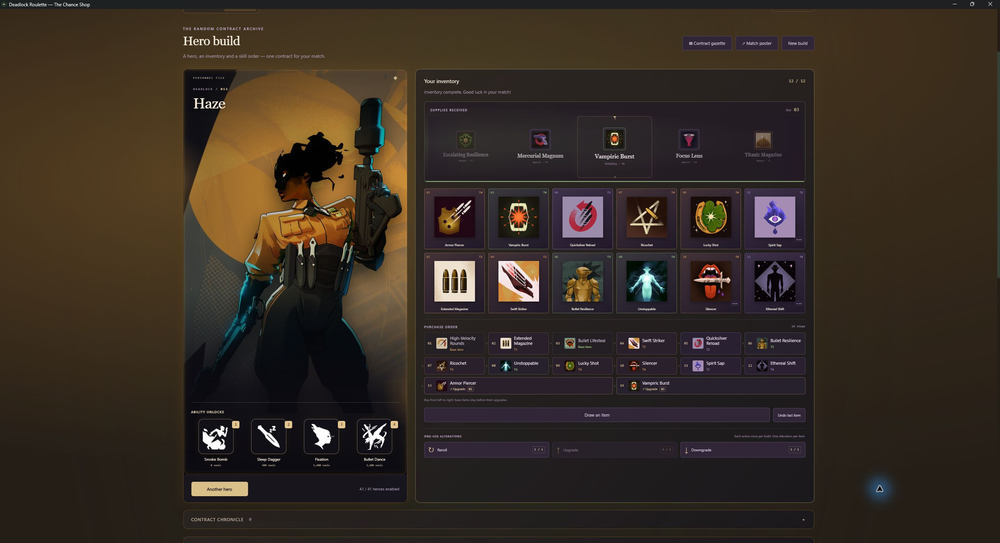
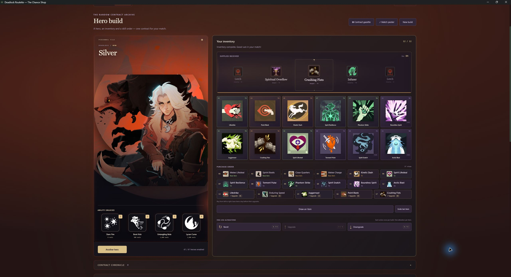
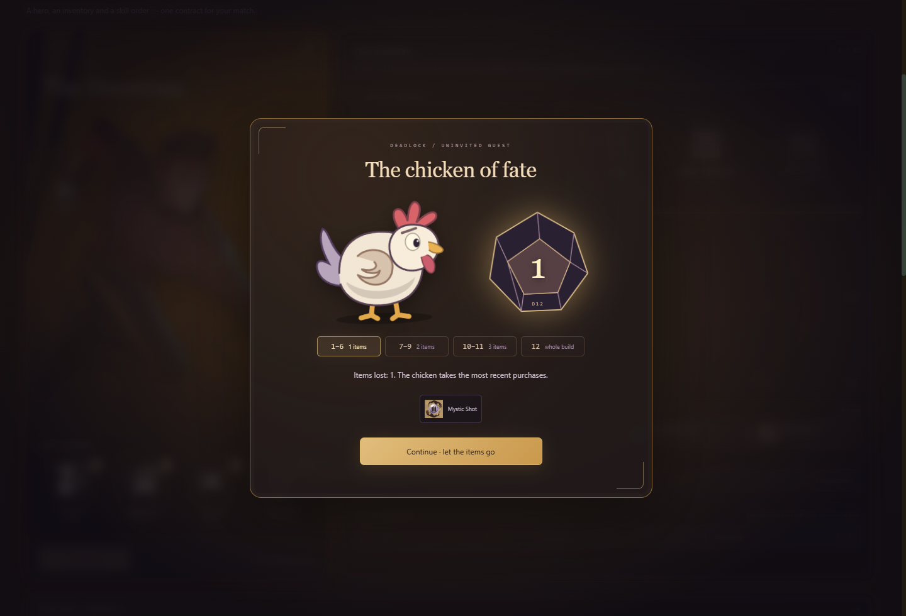
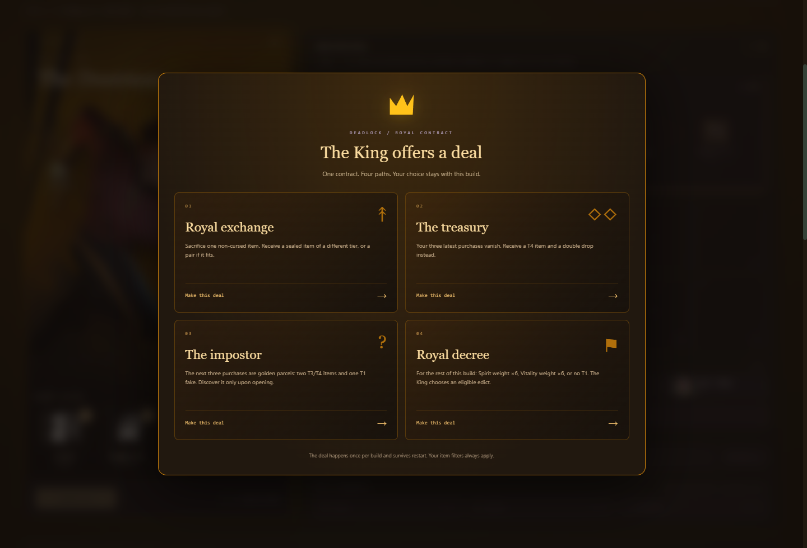

# Deadlock Roulette — The Chance Shop

[English](#english) · [Русский](#русский)

## English

**A random hero. An unpredictable build. One contract for your next match.**

An offline Windows app for playing Deadlock with whatever chance gives you. Spin for items, draft a complete hero build, follow the purchase route and ability upgrades, and try to survive the Chicken of Fate.

**[Download for Windows](https://github.com/satotory/deadlock-roulette/releases/latest)** · [Detailed guide in Russian](docs/FEATURES.md) · [Audio sources](docs/audio-sources.md)

### Download and play

1. Open the [latest release](https://github.com/satotory/deadlock-roulette/releases/latest) and download the `.exe` under **Assets**.
2. Run it. No installation, administrator access, server or account is needed.
3. Choose **Item roulette** or **Hero build**. Enable the items and heroes you want, then start drawing.

**Windows download notice:** Release 1.9.0 is unsigned, so Windows may show **Unknown publisher** or a SmartScreen warning. See [how to verify the official download](docs/WINDOWS-DOWNLOAD.md#english) before deciding whether to run it; changing your protection settings is unnecessary.

The portable app supports **Windows 10/11 x64**. Icons, hero art, music, sounds and voices are bundled; playing does not require an internet connection.

### A look inside

**Item roulette — T4 pool, with a hovered segment.** Every sector displays its item icon; hovering enlarges the selected sector and shows its item card.



**Haze — a full inventory and a 14-step purchase route.** Components stay in the route after upgrading, so the final inventory never erases how to build it.



**Silver — a different hero, different colours and a different build.** This contract has seventeen purchase steps, including its component upgrades.



The interface supports **English and Russian**, adjustable scale from **75% to 250%**, fullscreen and a faster animation mode. The hero page adopts the selected character’s colours, with soft ambient lighting and staged ability reveals.

### Item roulette: weights, filters and repeats

Choose **Weapon / Vitality / Spirit**, enable tiers **T1–T4**, or opt into the separate **Legendary** pool. Legendary items are off by default. Search understands both English and Russian names; opening an item shows its description and lets you exclude it or change its individual weight.

Default tier weights are **T1 = 4, T2 = 3, T3 = 2, T4 = 1**. Each item’s weight is its tier weight × category weight × individual multiplier. Its chance is that weight divided by the total eligible weight. This means a particular T1 item starts with four times the weight of a particular T4 item; the total chance of a tier also depends on how many eligible items it contains. A weight of zero excludes an item.

A normal draw removes its item from that mode’s pool until reset. Changing filters or restarting the app does not bring it back. Roulette and hero builds keep separate histories. Hover over a stopped wheel segment to enlarge it and inspect the item; the lower item catalogue can be hidden.

### Hero builds: inventory and purchase order

Choose which heroes participate, then draw one. Enabled heroes have equal chances; hero selection can repeat. The build receives **12 item slots: 9 base slots and 3 Flex slots**. Drawn items do not duplicate existing ones.

The inventory shows what the final build contains. The **purchase route** underneath shows how to get there, step by step:

- An upgrade combines with owned components and frees their slots. For example, **Mystic Vulnerability → Escalating Exposure** becomes one final item.
- The component remains an earlier purchase step, so you can still follow the full buying order.
- Late **T1** items move to a random early position from **1 to 5** instead of becoming late-game purchases.
- A full inventory can still accept an eligible upgrade that replaces its component.

Recipe checks, tier filters and slot capacity apply to the draw. Normal undo restores the whole last draw, including merges and moved items. It does not refund spent alteration charges.

### Ability unlocks and upgrades

The three basic abilities unlock in random order; the ultimate unlocks fourth. That unlock sequence sits on the hero poster.

The upgrade grid is a separate plan: read its **12 steps from left to right**. Ranks of the same ability stay in order and cost **1 / 2 / 5 AP**, for **32 AP** across the complete build. The first upgrade belongs to the first unlocked ability. Wait for the ability to unlock and enough AP in the match, then click its diamond to track the purchase. The next step is highlighted.

**New build** and **Shuffle skill order** ask for confirmation before clearing or replacing your progress.

### Reroll, upgrade and downgrade

Each option has **one charge per roulette session or hero build**, with separate charges for the two modes. A result may be altered only once. Spending one option disables it for subsequent items until reset.

| Action | Item roulette | Hero builder |
| --- | --- | --- |
| Reroll | Shows another result without removing it from the pool or adding a purchase. | Replaces the latest item draw. |
| Upgrade | Draws an eligible item exactly one tier higher. | Replaces the latest draw with an eligible result exactly one tier higher. |
| Downgrade | Draws an eligible item exactly one tier lower. | Replaces the latest draw with an eligible result exactly one tier lower. |

Actions respect filters, weights and available items. Replaced builder items remain excluded until reset. Cursed items cannot be altered or undone. Sealed royal rewards must be revealed before an eligible alteration; a royal deal itself cannot be undone.

### Dynamic tier weights

Hero builds have their own tier switches and a balancing rule that is **on by default**. Each owned item of a tier multiplies the remaining items’ tier weight by **0.2**. After one, two and three such items, the multiplier is **20%, 4% and 0.8%** of the original weight.

This discourages a fourth item from a heavily represented tier without forcing an exact distribution. The tier panel shows counts and current chances. Turning the rule off restores the base weights.

### Double drops and charge compatibility

**20 curated pairs** enter the reel alongside their two individual items. A double drop uses **two normal slots**, not a special slot; it does not duplicate an item already owned. Pairs respect both components’ filters and can be switched off.

A pair’s weight is the average of its components’ weights × **0.35**. It is an additional possible outcome; the two single-item outcomes remain in the pool.

**Extra Charge, Rapid Recharge and Recharging Rush** are excluded for heroes without abilities that use charges, including charges unlocked through ability upgrades. The Legendary **Omnicharge Signet** remains eligible because it supplies charges itself.

### Curses

The default curse chance is **50%**, adjustable from **0% to 100%**. Each ordinary item gets its own check; both halves of a double drop are checked separately.

A curse immediately draws an additional single item and marks it with a **lock on its icon**. That bonus item cannot be altered or undone, and it does not trigger another curse. Capacity and pool rules still apply; a curse cannot create an extra item if no valid slot or item remains.

### Three once-per-build events

**Chicken, Archmother and Hidden King each default to a 10% chance**, with independent controls from **0% to 100%**. Set one to zero to disable it. Each can appear **only once in the current build**; undo and restarting do not restore it. A new build or item reset restores the events.

These events trigger from ordinary builder draws, not the reroll / upgrade / downgrade buttons. Click an event’s name or symbol in the chance settings to read its rules. Used events receive a visible seal, and the **Contract Chronicle** records what happened.

### Chicken of Fate

Once the inventory has at least **three items**, she can appear and roll a **D12**. She takes the most recently received items, even if T1 items have moved earlier in the buying order.

| D12 result | Consequence |
| --- | --- |
| 1–6 | Lose the latest item. |
| 7–9 | Lose the latest two items. |
| 10–11 | Lose the latest three items. |
| 12 | Lose the entire inventory. Draw a fresh build under a curse: every new item is locked. |

The extended roll pauses on its result until you press **Continue**. The removed items shed feathers; the chronicle keeps the die result and losses. A roll of 12 adds a chicken mark to each replacement item and locks drawing, alterations and undo until reset. A limited eligible pool fills only as many slots as it can.

The result is saved before the animation. Closing the app cannot reroll the die; reopening returns the same result and confirmation.



### The Archmother’s gifts

Three **independent vertical reels** spin and stop one after another. Once all three settle, choose **one of the three different single items**. The other two remain in the pool.

The chosen gift goes straight into the build, without another horizontal spin. A blue Archmother mark stays on the item, purchase route and saved build, and the chronicle records your choice. A normal curse can still follow the gift. Restarting returns the same pending offer.

### A deal with the Hidden King

The King may arrive only with at least **five items in the inventory**. Choose one available contract:

| Deal | What you risk and receive |
| --- | --- |
| **Royal exchange** | Sacrifice one non-cursed item for a sealed item of a different tier — higher or lower — or a two-item pair if it fits. |
| **The treasury** | Give up the three most recently received items. Receive **one T4 item and a two-item pair**: three distinct sealed rewards. |
| **The impostor** | Your next **three single purchases** become golden parcels: **two T3/T4 items and exactly one T1 fake**, in a hidden order. |
| **Royal decree** | The King chooses an eligible rule for the remaining build: **Spirit weight ×6**, **Vitality weight ×6**, or **no T1 items**. |

Contracts respect your item filters, charge compatibility, recipes and inventory capacity. An unavailable deal shows its reason instead of bypassing the rules. The decree changes this build’s behaviour, not your saved base preferences.

Royal rewards carry a crown. Open sealed purchases **one at a time, in purchase order**, when you reach them during the match. Their contents are fixed when the deal is accepted; revealing does not reroll anything. The impostor receives a red counterfeit mark only after discovery. Alterations and undo wait while the three-parcel queue is unfinished.

Your choice and unfinished sacrifice selection survive restarting. Existing 1.8 saves retain their original veil mode, which hides future purchases; new builds use the four contracts.



### Save, review and share a build

The archive holds up to **30 contracts**. Give one a name, a star rating and a comment; preview its hero, inventory and skills before loading it. After a match, edit the **existing** rating and comment without creating another copy. **Play Again** restores the build and resets ability checkmarks for the next match.

Export a **match poster** with the hero, final inventory, full purchase route and skill plan, or turn the contract into an illustrated **city gazette** with headlines and event history. Both save as PNG. Sealed purchases stay hidden in previews and images until you reveal them.

### Sound, music and controls

Choose among **Street Brawl, Wood, Revolver, Crystal, Arcade and Mechanical** reel sounds. Tick timing follows the actual card or wheel boundaries, including the slow final steps. Street Brawl adds the original item-landing shot and category accents.

There are **six local music tracks** and an original selection quote for every included hero. Music, draws, interface effects and hero voices each have a **separate saved volume and mute switch**. Track choice and sound style also persist.

- **Space:** draw.
- **Ctrl K:** item search.
- **Ctrl + / Ctrl −**, **Ctrl + mouse wheel:** change scale.
- **Ctrl 0:** restore 100% scale.
- **F11:** fullscreen.
- **Escape:** close ordinary dialogs or leave fullscreen.

Outcome-choice dialogs wait for your decision. The app respects Windows’ reduced-animation preference.

### Persistence and JSON

The app saves settings, pool exclusions, current build, spent charges, pending events and archives in `%APPDATA%\Deadlock Roulette`. **Save / Load** exports or imports the full session as JSON. A session reset restores its item pool and charges while retaining filters and preferences.

### Use the sounds in another project

The generated ticks and interface effects live in [src/audio.js](src/audio.js); available styles are listed in [src/sound-palette.js](src/sound-palette.js). Original Street Brawl landing samples are in [assets/audio/street-brawl](assets/audio/street-brawl). The game recordings belong to Valve and are distinct from the effects synthesized by this app. See [audio sources and extraction notes](docs/audio-sources.md).

### Run from source or build an EXE

Install Node.js and npm, then run in the project folder:

```powershell
npm ci
npm start
```

Run the tests and build the Windows portable app:

```powershell
npm test
npm run build
```

The build produces `dist/Deadlock Roulette.exe`. On Windows, use `npm.cmd` if PowerShell blocks `npm`. No backend is needed.

### Catalogue and credits

The bundled snapshot is dated **14 October 2026**: **173 items, 41 heroes and 164 abilities**. Deadlock changes; this is the included snapshot date, not an automatic live catalogue.

Sources: [items](docs/catalog-sources.md), [heroes and abilities](docs/hero-sources.md), [recipes and charge rules](docs/game-rules-sources.md), [audio](docs/audio-sources.md), [patron colours and symbols](docs/fate-presentation-sources.md).

This is an unofficial fan project, unaffiliated with Valve. Deadlock, characters, artwork, music and original game recordings belong to Valve Corporation. The random-build events are custom app rules, not ordinary Deadlock match mechanics.

---

## Русский

**Случайный герой. Непредсказуемый билд. Один контракт на следующий матч.**

Приложение для Windows, чтобы играть в Deadlock тем, что выпало. Крути предметы, собирай билд на героя, следуй порядку закупа и прокачки — и постарайся пережить Курицу судьбы.

**[Скачать для Windows](https://github.com/satotory/deadlock-roulette/releases/latest)** · [Подробное руководство](docs/FEATURES.md) · [Источники звуков](docs/audio-sources.md)

### Скачать и начать играть

1. Открой [последний релиз](https://github.com/satotory/deadlock-roulette/releases/latest) и скачай `.exe` из раздела **Assets**.
2. Запусти файл. Установка, права администратора, сервер и аккаунт не нужны.
3. Выбери **«Рулетка предметов»** или **«Билд на персонажа»**, настрой пул и начинай розыгрыш.

**При скачивании на Windows:** Версия 1.9.0 не подписана, поэтому могут появиться **«Неизвестный издатель»** или предупреждение SmartScreen. Перед запуском [проверь официальный файл по инструкции](docs/WINDOWS-DOWNLOAD.md#русский); менять настройки защиты не требуется.

Переносимая версия работает на **Windows 10/11 x64**. Иконки, герои, музыка, звуки и реплики уже внутри файла; интернет во время игры не нужен.

### Как это выглядит

**Рулетка предметов — только T4 и наведение на сектор.** На каждом секторе видна иконка предмета; под курсором сектор увеличивается и появляется карточка.


**Haze — полный инвентарь и маршрут из 14 покупок.** Компоненты остаются в маршруте после улучшения: итоговый инвентарь не стирает порядок сборки.


**Silver — другой герой, другая палитра и другая сборка.** В этом контракте 17 покупок с учётом компонентов улучшений.


Есть **русский и английский интерфейс**, масштаб **75–250%**, полноэкранный и быстрый режимы. Цвет страницы плавно меняется под героя, вокруг карточки движется мягкий свет, а умения открываются по очереди.

### Рулетка: веса, фильтры и отсутствие повторов

Выбирай **Ган / ХП / Спирит**, включай нужные тиры **T1–T4** и при желании отдельный пул **Legendary** — изначально он выключен. Поиск понимает оба языка. В карточке предмета можно прочитать описание, исключить вещь или изменить её личный вес.

Стартовые веса: **T1 = 4, T2 = 3, T3 = 2, T4 = 1**. Вес предмета равен весу тира × весу категории × личному множителю. Шанс — его вес, поделённый на сумму весов доступных предметов. Поэтому конкретный T1 изначально имеет вчетверо больший вес, чем конкретный T4; общий шанс тира также зависит от количества вещей в нём. Нулевой вес исключает предмет.

Обычный розыгрыш убирает предмет из пула режима до сброса. Изменение фильтров и перезапуск его не возвращают. У рулетки и билдера отдельные истории. Наведи мышку на сектор остановленного колеса, чтобы увеличить его и рассмотреть предмет; нижний каталог можно скрыть.

### Билд героя: инвентарь и порядок покупок

Выбери участников и разыграй героя. У включённых персонажей одинаковые шансы; сами герои могут повторяться. Для предметов есть **12 слотов: 9 основных и 3 Flex**. Уже имеющиеся вещи не дублируются.

Инвентарь показывает финальный состав, а **маршрут покупок** под ним — как его собрать:

- Улучшение объединяется с имеющимися компонентами и освобождает слоты. Например, **Mystic Vulnerability → Escalating Exposure** превращается в один итоговый предмет.
- Компонент остаётся ранним шагом закупа, чтобы последовательность не терялась после объединения.
- Поздний **T1** вставляется в случайную раннюю позицию **от 1 до 5**, вместо того чтобы становиться покупкой на конец игры.
- Даже при полном инвентаре можно разыграть подходящее улучшение, заменяющее свой компонент.

Учитываются рецепты, фильтры и свободное место. Обычная отмена восстанавливает весь последний розыгрыш, включая объединения и перестановки, но не возвращает потраченные заряды правок.

### Открытие умений и прокачка

Три обычных умения открываются в случайном порядке, ультимейт — четвёртым. Эта последовательность находится на постере героя.

Таблица улучшений — отдельный план: читай **12 шагов слева направо**. Ранги одного умения идут последовательно и стоят **1 / 2 / 5 AP**; полный билд расходует **32 AP**. Первое улучшение относится к первому открытому умению. Дождись его открытия и нужного числа AP в матче, затем нажми ромб, чтобы отметить покупку. Следующий шаг подсвечивается.

Перед **«Новым билдом»** и **«Перемешать прокачку»** появляется подтверждение, чтобы случайно не потерять прогресс.

### Реролл, апгрейд и даунгрейд

У каждой опции **один заряд на сессию рулетки или текущий билд**. Между режимами заряды раздельные. На один результат можно применить только одну правку; потраченная опция выключается для следующих предметов до сброса.

| Действие | Рулетка предметов | Билдер героя |
| --- | --- | --- |
| Реролл | Показывает другой результат, не удаляя его из пула и не добавляя покупку. | Заменяет последний розыгрыш предмета. |
| Апгрейд | Разыгрывает доступную вещь ровно на тир выше. | Заменяет последний розыгрыш подходящим результатом ровно на тир выше. |
| Даунгрейд | Разыгрывает доступную вещь ровно на тир ниже. | Заменяет последний розыгрыш подходящим результатом ровно на тир ниже. |

Правки учитывают фильтры, веса и оставшийся пул. Заменённые в билдере вещи остаются исключёнными до сброса. Проклятые предметы нельзя менять и отменять. Закрытую королевскую награду сначала нужно раскрыть; саму сделку отменить нельзя.

### Динамические веса тиров

У билдера отдельные выключатели тиров и правило баланса, **включённое по умолчанию**. Каждый имеющийся предмет тира умножает вес оставшихся вещей этого тира на **0,2**. После одного, двух и трёх предметов остаётся **20%, 4% и 0,8%** исходного веса.

Это сильно снижает шанс четвёртой вещи уже заполненного тира, но не навязывает точный состав. Панель показывает количество предметов и текущие шансы. Выключение правила возвращает базовые веса.

### Двойные находки и совместимость зарядов

**20 готовых связок** участвуют в барабане рядом с одиночными предметами. Дабл занимает **два обычных слота**, а не особый слот, и не дублирует уже имеющуюся вещь. Оба компонента должны пройти фильтры; связки можно выключить.

Вес связки — средний вес её компонентов × **0,35**. Это дополнительный возможный исход: обе одиночные вещи также остаются в пуле.

**Extra Charge, Rapid Recharge и Recharging Rush** не выпадают героям без умений с зарядами, в том числе без зарядов, открываемых улучшением способности. Legendary-предмет **Omnicharge Signet** доступен, потому что сам добавляет заряды.

### Проклятия

Шанс проклятия по умолчанию — **50%**, настройка — от **0% до 100%**. Проверяется каждый обычный предмет; у дабла обе половины проходят отдельную проверку.

Проклятие сразу разыгрывает ещё один одиночный предмет и вешает **замок на его иконку**. Такой бонус нельзя изменить или отменить, и он не вызывает следующее проклятие. Правила пула и вместимости сохраняются: без подходящего предмета или свободного места дополнительной вещи не будет.

### Три события — по одному разу за билд

У **Курицы, Архиматери и Тайного короля по 10%** по умолчанию, с отдельными настройками **0–100%**. Ноль отключает событие. Каждое может появиться **только один раз в текущем билде**; отмена и перезапуск его не возвращают. Новый билд или сброс предметов восстанавливают события.

Они запускаются обычными розыгрышами билдера, а не кнопками реролла / апгрейда / даунгрейда. Нажми название или значок события в настройках шансов, чтобы прочитать его правила. Сработавшие события отмечаются заметной печатью, а **«Хроника контракта»** сохраняет произошедшее.

### Курица судьбы

Когда в инвентаре уже минимум **три предмета**, она может появиться и бросить **D12**. Курица забирает последние полученные вещи, даже если T1 переставились в начало закупа.

| Результат D12 | Что произойдёт |
| --- | --- |
| 1–6 | Исчезнет последний предмет. |
| 7–9 | Исчезнут два последних предмета. |
| 10–11 | Исчезнут три последних предмета. |
| 12 | Исчезнет весь инвентарь. Новый билд разыграется под проклятием: все вещи будут заперты. |

Долгий бросок останавливается на результате и ждёт **«Продолжить»**. Из выклёванных иконок вылетают перья; число и потери записываются в хронику. На 12 каждая новая вещь получает значок курицы, а розыгрыши, правки и отмена блокируются до сброса. Если доступный пул слишком узкий, он заполняет столько слотов, сколько возможно.

Исход сохраняется до анимации. Перезапуск не переигрывает кубик: приложение вернётся к тому же результату и подтверждению.


### Дары Архиматери

Три **независимых вертикальных барабана** крутятся и останавливаются по очереди. Когда все остановились, выбери **один из трёх разных одиночных предметов**. Два остальных остаются в пуле.

Дар сразу попадает в билд, без второй горизонтальной рулетки. На вещи, маршруте и сохранённой сборке остаётся синяя метка Архиматери; выбор записывается в хронику. После дара может сработать обычное проклятие. Перезапуск возвращает то же незавершённое предложение.

### Сделка с Тайным королём

Король может прийти только при наличии минимум **пяти предметов в инвентаре**. Выбери одну доступную сделку:

| Сделка | Чем рискуешь и что получаешь |
| --- | --- |
| **Королевский обмен** | Отдай один непроклятый предмет за запечатанную вещь другого тира — выше или ниже — либо за связку, если она помещается. |
| **Тайная казна** | Отдай три последних полученных предмета. Получи **одну вещь T4 и связку из двух**: три разных запечатанных награды. |
| **Самозванец** | Следующие **три одиночные покупки** станут золотыми свёртками: **две вещи T3/T4 и ровно одна подделка T1**, в неизвестном порядке. |
| **Королевский указ** | Король выбирает доступное правило до конца билда: **вес спирита ×6**, **вес ХП ×6** или **запрет T1**. |

Сделки учитывают фильтры, заряды героя, рецепты и свободные слоты. Невозможная опция показывает причину, а не обходит твои правила. Указ действует в текущем билде и не меняет сохранённые базовые настройки.

На наградах остаётся корона. Открывай закрытые покупки **по одной, в порядке закупа**, когда дойдёшь до них во время матча. Содержимое фиксируется при принятии сделки: раскрытие ничего не переролливает. У подделки появляется красная метка только после обнаружения. Пока три королевских свёртка не получены, правки и отмена недоступны.

Сделка и незаконченный выбор жертвы переживают перезапуск. Старые сохранения 1.8 сохраняют прежний режим скрытия будущих покупок; новые билды используют четыре сделки.


### Сохранить, оценить и поделиться

Архив хранит до **30 контрактов**. Дай билду имя, звёзды и комментарий; перед загрузкой посмотри героя, предметы и прокачку в предпросмотре. После матча можно изменить оценку и комментарий **того же контракта**, не создавая копию. **Play Again** восстанавливает билд и сбрасывает отметки умений для нового матча.

Экспортируй **постер матча** с героем, инвентарём, полным закупом и прокачкой или преврати контракт в **городскую газету** с заголовками и историей событий. Оба формата сохраняются в PNG. Запечатанные покупки остаются скрытыми в предпросмотрах и изображениях до раскрытия.

### Звуки, музыка и управление

Для прокрутки доступны **Street Brawl, дерево, револьвер, кристалл, аркада и механика**. Щелчки совпадают с реальным прохождением карточек и секторов, включая медленные последние шаги. Street Brawl добавляет оригинальный выстрел выпадения и звуковой слой категории.

Есть **шесть фоновых треков** и оригинальная реплика выбора для каждого героя каталога. Музыка, розыгрыши, интерфейс и голоса имеют **четыре отдельные сохраняемые громкости и выключатели**. Выбор трека и звуковой палитры тоже сохраняется.

- **Пробел:** розыгрыш.
- **Ctrl K:** поиск предметов.
- **Ctrl + / Ctrl −**, **Ctrl + колёсико мыши:** масштаб.
- **Ctrl 0:** вернуть 100%.
- **F11:** полный экран.
- **Escape:** закрыть обычный диалог или выйти из полного экрана.

Окна выбора исхода ждут твоего решения. Учитывается настройка уменьшения анимации Windows.

### Сохранение сессии и JSON

Настройки, исключённые предметы, текущий билд, потраченные заряды, незавершённые события и архив сохраняются в `%APPDATA%\Deadlock Roulette`. **«Сохранить / Загрузить»** экспортирует или импортирует полную сессию в JSON. Сброс сессии восстанавливает пул предметов и заряды, сохраняя фильтры и предпочтения.

### Если нужны только звуки

Синтезированные щелчки и эффекты интерфейса находятся в [src/audio.js](src/audio.js), список стилей — в [src/sound-palette.js](src/sound-palette.js). Оригинальные выстрелы выпадения Street Brawl лежат в [assets/audio/street-brawl](assets/audio/street-brawl). Игровые записи принадлежат Valve и отличаются от эффектов, которые генерирует само приложение. Подробности — в [источниках звуков и описании извлечения](docs/audio-sources.md).

### Запуск исходников и сборка EXE

Установи Node.js и npm, затем выполни в папке проекта:

```powershell
npm ci
npm start
```

Проверить логику и собрать переносимую версию для Windows:

```powershell
npm test
npm run build
```

Результат — `dist/Deadlock Roulette.exe`. Если PowerShell блокирует `npm`, используй `npm.cmd`. Серверная часть не нужна.

### Каталог и авторство

Встроен снимок **от 14 октября 2026 года**: **173 предмета, 41 герой и 164 способности**. Deadlock обновляется; это дата включённого каталога, а не автоматические живые данные.

Источники: [предметы](docs/catalog-sources.md), [герои и умения](docs/hero-sources.md), [рецепты и заряды](docs/game-rules-sources.md), [звуки](docs/audio-sources.md), [цвета и символы покровителей](docs/fate-presentation-sources.md).

Это неофициальный фанатский проект, не связанный с Valve. Deadlock, персонажи, изображения, музыка и оригинальные игровые записи принадлежат Valve Corporation. События случайного билда придуманы для приложения и не описывают механику обычного матча.
